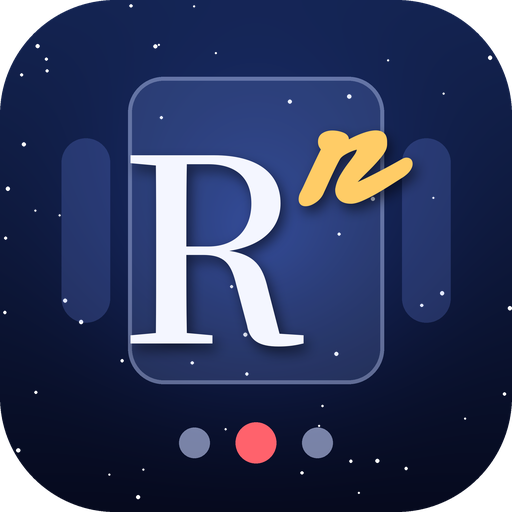

# ResearchReels 🎞️
### Top-venue research, one swipe at a time.

**Stop scrolling through 14-page PDFs. Start swiping through the ideas that matter.**

**Scan to open** · or visit **https://bibek-cse.github.io/research-reels/**

---

## ✨ What is ResearchReels?

ResearchReels turns the latest research papers into **short, swipeable reels**, like Inshorts or Instagram Stories but made for researchers.

Each paper becomes a 60-second story: **why it matters → key points → what's new → the real architecture figure → results → limitations**, with a one-tap link to the original paper.

Built for PhD students, researchers and engineers working on:

> 🎭 **Deepfakes** · ⌕ **Media forensics** · ◈ **Watermarking & provenance** · ◉ **Face** · 〰 **Voice / audio** · ✍ **Signature** · ⬡ **Biometric security** · ▤ **Document analysis (ICDAR)** · ⧉ **DL architectures** · ◎ **Computer vision**

---

## 🚀 Why researchers love it

### 🏆 Only research worth your time
About 90% of the feed comes from **CORE A\* / A / B conferences, IEEE & ACM Transactions and Q1 journals**: CVPR, ICCV, ECCV, NeurIPS, ICLR, AAAI, ACM MM, Interspeech, WACV, ICDAR, ICASSP, IJCB, ICPR, TPAMI, TIFS, TIP, TMM, TBIOM, TASLP and more. It also covers the **biometrics & forensics society venues** (WIFS, ISBA, IWBF, BIOSIG). Every card shows a **venue badge** (`A* · CVPR`, `TIFS`…), so you know the quality at a glance.

### ⚡ Always fresh
No stale lists. Papers load **live from the internet** each time you open the app, including **IEEE Early Access** papers within days of publication.

### 🏗️ The real architecture, not a stock image
The app finds each paper's **original architecture figure**, crops it cleanly, and shows it like a journal figure with a proper citation: **[1] Author et al., Venue Year ↗**. Tap to zoom, or switch between the paper's figures.

### 🔍 "Explain this architecture"
Stuck on a complicated diagram? One tap shows the **authors' own explanation** of that figure. Add a free AI key and you get a plain-English walkthrough: building blocks → data flow → training → why it works.

### 🎓 Campus mode
On your **institute Wi-Fi** (IIT, NKN, ERNET and more), ResearchReels detects your campus access automatically. It loads **more papers, including subscription-only IEEE/ACM ones**, and opens the full text straight away.

### 📊 SOTA at a glance
A **state-of-the-art table for every domain**: key models, venue, year, core idea, paper and code. Plus a live **📈 Rising now** list of the fastest-growing new papers.

### ⏰ Never miss a deadline
**Live conference deadlines** with CORE ranks and countdowns in your time zone. A reminder banner appears when a deadline is under 14 days away, and one tap adds it to your calendar with **7-day and 1-day alarms**.

### 💡 Ideas & concepts
- **Concept reels** explain hard topics (EER, Grad-CAM, ViT, diffusion, PAD, JND…) in plain language.
- **Fresh research ideas** generated from today's papers (optional AI).

### ❤️ Made for you
Like, save and search, and your **For You** feed learns what you care about. Everything stays on your device.

### 🎨 Your style
4 themes (🌙 Midnight · 📜 Paper · ⚡ Neon · 🌊 Ocean), accent colours, and covers that show either the paper figure or gradient art.

---

## 📱 Install it like an app

ResearchReels installs on your phone or laptop with its own icon and works offline with your cached content.

| Device | How |
|---|---|
| **Android / Chrome** | Open the link → tap **⤓** or menu → **Install app** |
| **iPhone / iPad** | Open in Safari → **Share** → **Add to Home Screen** |
| **Desktop** | Click the install icon in the address bar |

---

## 🔒 Free, private & secure

- **100% free**: no sign-up, no ads, no subscription.
- **Private**: no accounts, no cookies, no tracking. Your likes, saves and interests stay in your own browser.
- **Secure by design**: strict Content-Security-Policy, no third-party scripts, all content safely escaped.
- **Optional AI keys** (Gemini / OpenRouter) are sent only to the provider you choose, and are forgotten when you close the tab unless you choose "Remember".
- Campus detection makes one network check per session and can be switched off in ⚙ Settings.

---

## 🧭 Good to know

- Paper data comes from **OpenAlex, Crossref, Semantic Scholar and arXiv**. Deadlines come from **ccf-deadlines**.
- Google Scholar has no public API, so every paper has a one-tap **G** button that opens it on Google Scholar.
- Architecture figures are available when a paper has an arXiv version. Otherwise you get a direct link to the PDF or publisher.
- Without an AI key, summaries come from the paper's abstract and Semantic Scholar's TL;DR. Always check numbers in the original paper.
- SOTA tables list reference models without scores. See each paper for exact results.

---

## 💬 Feedback

Found a bug, want a new venue or domain, or have an idea? Open an [issue](https://github.com/bibek-cse/research-reels/issues). Feedback is welcome!

If ResearchReels saves you time, **⭐ star this repo** and share the QR with your lab.

---

**ResearchReels** · Designed & built by **[Bibek (@bibek-cse)](https://github.com/bibek-cse)**

© 2026 Bibek (bibek-cse). **All rights reserved.**
This repository is public so the app can be hosted. It is **not** open source.
Copying, re-hosting or redistributing the code, design or logo without written permission is not allowed. See [LICENSE](LICENSE).

